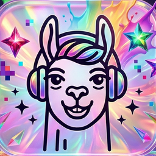
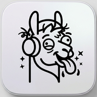
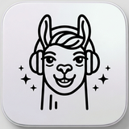
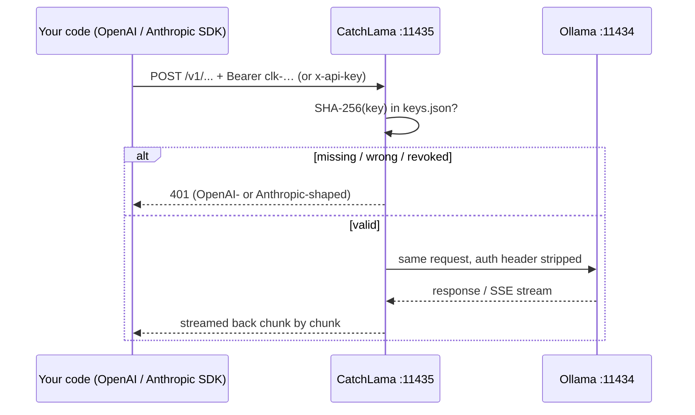

<p align="center">
  
</p>

<h1 align="center">CatchLama</h1>

<p align="center">
  <b>Turn your local Ollama into an API-key–protected AI provider, right from the macOS menu bar.</b><br>
  Your OpenAI / Anthropic / Spring AI code stays <i>identical</i> to the cloud version, so switching is just an env change.
</p>

---

## Why

[Ollama](https://ollama.com) already speaks the OpenAI (`/v1/chat/completions`, `/v1/responses`, `/v1/embeddings`) and Anthropic (`/v1/messages`) wire formats. However, it has **no authentication**: any string works as an API key, and anyone who can reach the port can use your models. The request for built-in auth ([ollama#8536](https://github.com/ollama/ollama/issues/8536)) is still open. The recommended workaround is a reverse proxy.

CatchLama is that reverse proxy, with three additions:

- **Real API keys.** Create a key per project, see and copy it any time, revoke it whenever you want. A revoked key gets `401` on the very next request.
- **Official code templates.** Pick a model and an SDK. You get the snippet from the vendor's official docs, extracted verbatim (only the model name changes), plus the env vars to point it at your machine.
- **Lives in the menu bar.** It shows whether Ollama and the proxy are up. The llama icon switches while a request is in flight.

```
                       ┌── local:  OPENAI_BASE_URL=http://localhost:11435/v1   OPENAI_API_KEY=clk-…
same code, two envs ───┤
                       └── cloud:  (unset OPENAI_BASE_URL)                     OPENAI_API_KEY=sk-…
```

## What happens without it

| Without CatchLama | With CatchLama |
| --- | --- |
| Local code hard-codes `base_url` and a fake `api_key="ollama"`, so going to the cloud means editing code | The SDK reads `*_BASE_URL` / `*_API_KEY` from the environment, so the code is the same in both places |
| Exposing Ollama on your LAN (`OLLAMA_HOST=0.0.0.0`) gives everyone your GPU **and** `/api/pull` / `/api/delete` | Only `/v1/*` (inference) is forwarded, and only with a valid key. Model management is not reachable through the proxy (`404`) |
| No idea which project is calling your models, no way to cut one off | One key per project, "last used" per key, one-click revoke |
| Snippets copied from memory or old blog posts (Chat Completions vs. Responses API, Spring AI 1.x vs. 2.x) | Snippets extracted from the current official docs and tested against a local model |

## Features

- Per-project API keys (`clk-…`, 256-bit random), always visible in the app. Pick a key and it goes straight into the template.
- Accepts both `Authorization: Bearer` (OpenAI SDKs) and `x-api-key` (Anthropic SDKs).
- Vendor-shaped errors: OpenAI-style `invalid_api_key` on `/v1/*` and Anthropic-style `authentication_error` on `/v1/messages`, so SDKs raise their normal `AuthenticationError`.
- True streaming pass-through (SSE chunks are forwarded as they arrive, not buffered).
- 8 official templates: **OpenAI** Python / JavaScript / Java / curl, **Anthropic** Python / TypeScript / curl, **Spring AI 2.x**.
- Model list with capabilities (`tools`, `vision`, `thinking`, …) read from Ollama.
- Menu bar icon reflects activity:  idle,  serving a request.
- Launch at login.

## Quick start

**Requirements:** macOS 14+, [Ollama](https://ollama.com) running locally, and Xcode 16+ (or a Swift 6 toolchain).

```bash
git clone https://github.com/berat-erkul/CatchLama.git
cd CatchLama
./scripts/bundle.sh        # release build → /Applications/CatchLama.app → launches it
```

1. Click the llama in the menu bar.
2. **Keys** → name it (e.g. `my-side-project`) → **Create**. The new key is selected automatically.
3. Pick a model and a template. Copy step **1** (env) into your terminal, then run step **2** (code) as-is.

```bash
export OPENAI_BASE_URL=http://localhost:11435/v1
export OPENAI_API_KEY=clk-...
```

```python
from openai import OpenAI

client = OpenAI()

response = client.responses.create(model="qwen2.5:3b", input="Write a short bedtime story about a unicorn.")

print(response.output_text)
```

To go to the real provider, unset `OPENAI_BASE_URL`, put in your real key, and change the model name. Nothing else changes.

| SDK | Base URL to use |
| --- | --- |
| OpenAI (Python / JS / Java) | `http://localhost:11435/v1` |
| Anthropic (Python / TS) | `http://localhost:11435` (the SDK appends `/v1/messages`) |
| Spring AI 2.x | `spring.ai.openai.base-url=http://localhost:11435/v1` |
| Spring AI 1.x | `http://localhost:11435` (1.x appended `/v1` itself) |

## How it works



CatchLama is a single native Swift app: a SwiftUI `MenuBarExtra` UI plus an embedded HTTP server ([Hummingbird 2](https://github.com/hummingbird-project/hummingbird)) that forwards to Ollama with [AsyncHTTPClient](https://github.com/swift-server/async-http-client). It has no database, no background daemon and no Electron.

**Deep dive:** [docs/HOW-IT-WORKS.md](docs/HOW-IT-WORKS.md) covers design decisions, the request lifecycle, the template pipeline, the icon tricks for macOS 26, how everything was verified, and what went wrong along the way.

## Security model (short version)

- Listens on **127.0.0.1 only**. Nothing is exposed to the network.
- Keys are 256-bit random and stored in `~/Library/Application Support/CatchLama/keys.json` with owner-only permissions (`0600`), so the app can always show them. Requests are matched by SHA-256 hash.
- Only `/v1/*` is forwarded; Ollama's model-management API is not reachable through CatchLama.
- There is no TLS, because traffic never leaves the machine. Read the deep dive before putting it on a network.

## Limitations

- macOS only (Apple Silicon and Intel should both work; only Apple Silicon was tested).
- Not notarized. Build from source with `scripts/bundle.sh`, or expect a Gatekeeper warning on a downloaded build.
- No usage metering, rate limits or LAN mode yet (see the roadmap).
- Launch at login uses `SMAppService` and hasn't been verified with the ad-hoc-signed build yet.
- On the same Mac, Ollama itself is still reachable on `:11434`. Locally, keys give you per-project organisation and revocation, not protection from other local processes.
- Templates were extracted from the official docs on 2026-10-14. Vendors change their docs, so re-check if something looks off.

## Roadmap

- [ ] Per-key usage (requests, tokens from `usage`)
- [ ] Model aliases (`gpt-…` → a local model), so even the model name in the code stays the same
- [ ] LAN mode: the proxy binds to the network while Ollama stays on loopback
- [ ] Capability-specific templates (tools, vision)

## Credits

- Built with [Hummingbird](https://github.com/hummingbird-project/hummingbird) and [AsyncHTTPClient](https://github.com/swift-server/async-http-client).
- Templates are extracted from the [OpenAI](https://developers.openai.com/api/docs), [Anthropic](https://platform.claude.com/docs/en/get-started) and [Spring AI](https://docs.spring.io/spring-ai/reference/api/chat/openai-chat.html) docs (sources are listed in `Templates.swift`).
- Icons were generated with Google Gemini and post-processed with `scripts/make-icons.py`.

CatchLama is an independent project and is **not affiliated with Ollama, OpenAI, Anthropic or Spring**.

## License

[MIT](LICENSE)
