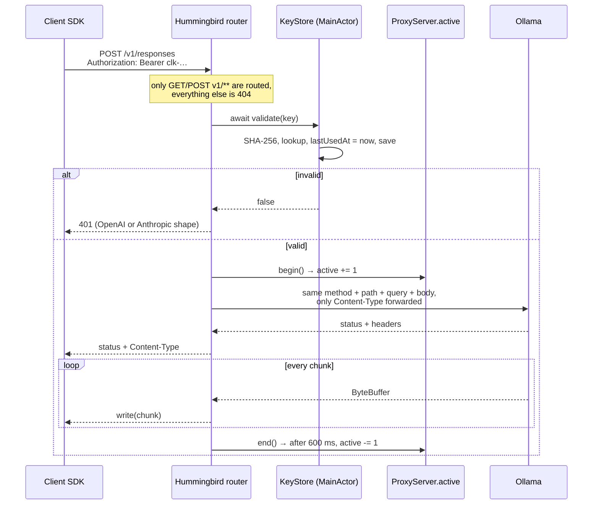
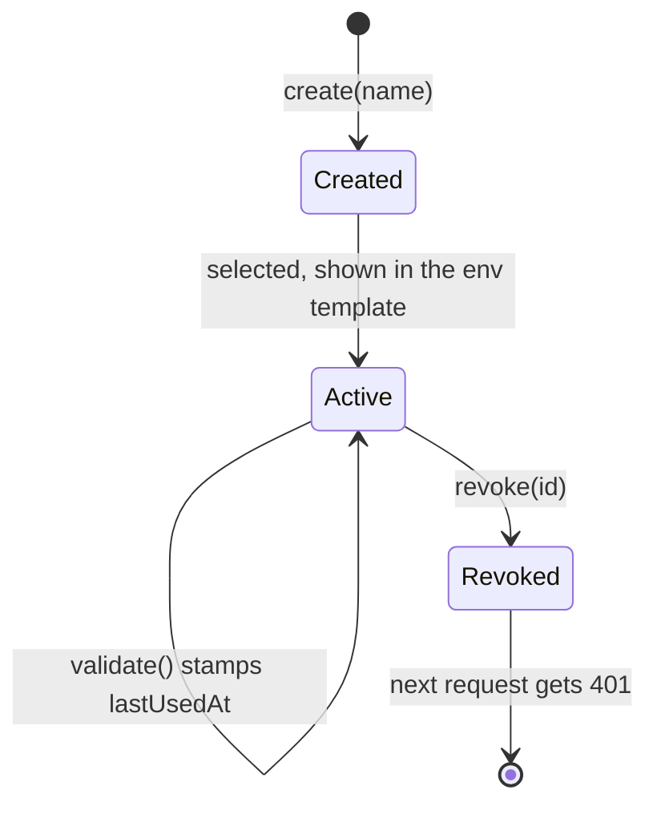
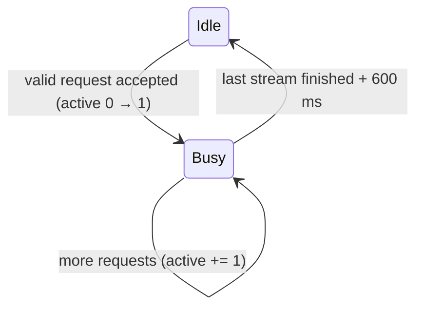

# How CatchLama works

This is the deep dive: why the project exists, how each piece is built, how it was verified, and what went wrong along the way. For installation and usage, see the [README](../README.md).

## Contents

1. [The problem](#1-the-problem)
2. [Existing options and where CatchLama fits](#2-existing-options-and-where-catchlama-fits)
3. [Architecture](#3-architecture)
4. [Request lifecycle](#4-request-lifecycle)
5. [API keys](#5-api-keys)
6. [Templates: identical code, different environment](#6-templates-identical-code-different-environment)
7. [Menu bar, icons and activity](#7-menu-bar-icons-and-activity)
8. [Packaging](#8-packaging)
9. [Verification](#9-verification)
10. [Security model](#10-security-model)
11. [Lessons learned](#11-lessons-learned)
12. [Roadmap](#12-roadmap)

---

## 1. The problem

### 1.1 What Ollama already gives you

These facts were verified against Ollama **0.40.2** on 2026-10-14:

- It listens on `127.0.0.1:11434` by default.
- It exposes OpenAI-compatible endpoints (`/v1/chat/completions`, `/v1/responses`, `/v1/embeddings`, `/v1/models`) and an Anthropic-compatible one (`/v1/messages`). All of them answered `400` to an empty body, which means the routes exist.
- `/api/tags` reports per-model `capabilities` (`completion`, `tools`, `vision`, `thinking`, `embedding`).
- `ollama serve -h` lists **no authentication-related environment variable**. Native API-key support is requested in [ollama#8536](https://github.com/ollama/ollama/issues/8536); the maintainers' answer so far is "use a reverse proxy".

So the wire format is solved. What is missing sits *around* it.

### 1.2 The three gaps

| Gap | Symptom |
| --- | --- |
| **No auth** | `OpenAI(api_key="anything")` works. Expose the port and everyone can use your GPU, and also `/api/pull` and `/api/delete`. |
| **Code divergence** | Tutorials tell you to hard-code `base_url="http://localhost:11434/v1"` and `api_key="ollama"`. That code is no longer the code you'd ship against a real provider. |
| **Stale snippets** | SDKs move: OpenAI's docs now lead with the **Responses API**, and **Spring AI 2.0** switched to the official OpenAI Java SDK (different base-URL semantics, different property names). Snippets written from memory are usually one version behind. CatchLama's own first version had exactly this bug (see [§11](#11-lessons-learned)). |

### 1.3 What happens without it

- **Switching to the cloud means editing code.** Every hard-coded base URL and fake key is a diff you have to remember to make, and to revert when you go back to local.
- **Sharing a machine is all-or-nothing.** To let a teammate or another device use your models you set `OLLAMA_HOST=0.0.0.0`, and now the whole Ollama API is open, including the endpoints that download and delete models.
- **No accountability.** You can't tell which project is hammering your GPU, and you can't cut one off without cutting off all of them.
- **Templates rot.** You copy a snippet from a blog post, it uses last year's API, and you debug the SDK instead of building your thing.

## 2. Existing options and where CatchLama fits

This survey was done on 2026-10-14 and is not exhaustive.

| Option | Auth | Notes |
| --- | --- | --- |
| Ollama itself | none | [ollama#8536](https://github.com/ollama/ollama/issues/8536) is still open |
| [LM Studio](https://lmstudio.ai/docs/developer/core/authentication) ≥ 0.4.0 | optional tokens, managed in the app | Built-in, but for LM Studio, not Ollama |
| [Jan](https://docs.jan.ai/local-server/api-server) | one custom key | Also serves `/v1/messages` |
| [LiteLLM proxy](https://docs.litellm.ai/docs/proxy/virtual_keys) | virtual keys, budgets, scopes | Powerful, but needs Postgres plus a master key; it is a server, not a desktop app |
| [ollama-proxy](https://github.com/julienrbrt/ollama-proxy) (Go) | one shared token from an env var | Tiny and headless |
| [ollama-token-api](https://github.com/ClowderTech/ollama-token-api) | tokens in MongoDB | Headless |
| nginx / Caddy ([guide](https://dev.to/munimv2/your-local-ollama-has-no-api-key-heres-how-to-require-one-caddy-or-nginx-and-still-use-open-322g)) | header match | DIY; the key lives in a config file |

**CatchLama's niche:** Ollama users on macOS who want *per-project* keys, a one-click UI, and copy-paste templates that are byte-for-byte the official ones. No existing tool found in this survey combines all three, but each piece on its own exists elsewhere.

## 3. Architecture

```mermaid
graph LR
    subgraph CatchLama.app
        UI[MenuView<br/>SwiftUI MenuBarExtra]
        KS[KeyStore<br/>@MainActor, keys.json]
        PX[ProxyServer<br/>Hummingbird :11435]
        T[Templates<br/>generated from official docs]
        OL[Ollama.models<br/>GET /api/tags]
    end
    SDK[Your code] -->|/v1/* + key| PX
    PX -->|validate| KS
    PX -->|AsyncHTTPClient| O[(Ollama :11434)]
    UI --> KS
    UI --> T
    UI --> OL --> O
    PX -. active count .-> UI
```

| File | Responsibility |
| --- | --- |
| `Sources/CatchLama/CatchLamaApp.swift` | `@main`. Creates `KeyStore` and `ProxyServer`, starts the proxy, renders the menu bar icon based on activity. |
| `Sources/CatchLama/ProxyServer.swift` | HTTP server, routing, key check, forwarding, streaming, activity counter. |
| `Sources/CatchLama/KeyStore.swift` | Create / list / revoke / validate keys; JSON persistence. |
| `Sources/CatchLama/Ollama.swift` | Reads the model list and capabilities. |
| `Sources/CatchLama/Templates.swift` | 8 official snippets plus env blocks. **Generated**; see [§6.3](#63-extraction-pipeline). |
| `Sources/CatchLama/MenuView.swift` | The popover UI. |
| `scripts/bundle.sh` | Release build, then `.app` bundle, then `/Applications`, then relaunch. |
| `scripts/make-icons.py` | `art/` to `Resources/` (app icon `.icns` and menu bar template PNGs). |

**Why a proxy and not a fork of Ollama?** A fork would have to be rebased on every Ollama release. A proxy only depends on the HTTP contract, which Ollama keeps stable because the whole point of `/v1/*` is compatibility.

**Why one process?** The UI and the proxy share the `KeyStore` instance in memory, so a revoke in the UI takes effect on the next request with no IPC, no file watching and no daemon.

## 4. Request lifecycle



### 4.1 Routing

Only `GET v1/**` and `POST v1/**` are registered. Everything else, including Ollama's native `/api/*` management API, never reaches Ollama and returns `404`. This was verified with `DELETE /api/delete` and `POST /api/pull`: both returned 404, and the model was still listed afterwards.

### 4.2 Reading the key

OpenAI SDKs send `Authorization: Bearer <key>`; Anthropic SDKs send `x-api-key: <key>`. CatchLama accepts either one. The Bearer header wins if both are present.

### 4.3 Validation

`KeyStore` is `@MainActor`, so the proxy (running on SwiftNIO event loops) hops to the main actor to validate. That hop is the whole concurrency story: the UI and the proxy never touch `keys` concurrently, and there is no lock to get wrong. Validation also stamps `lastUsedAt` and saves the file. For a local tool, one tiny atomic write per request is fine.

### 4.4 Forwarding

- The upstream URL is `http://127.0.0.1:11434` + the original path and query.
- The request body is collected up to **64 MB**, which leaves room for base64 images in vision requests, and sent as-is.
- Only `Content-Type` is forwarded. The client's auth header is deliberately **not** passed upstream.
- Upstream errors pass through untouched. For example, an unknown model returns Ollama's own `404 model '…' not found`.
- If Ollama is not running, the client gets a `502` with an OpenAI-shaped error that says so.

### 4.5 Streaming

The response body is written chunk by chunk as AsyncHTTPClient yields `ByteBuffer`s:

```swift
ResponseBody { writer in
    defer { Task { await server.end() } }
    for try await chunk in res.body { try await writer.write(chunk) }
    try await writer.finish(nil)
}
```

Things that were deliberately avoided:

- **`URLSession.bytes(for:).lines`** drops the empty lines that separate SSE events. That's why upstream calls use AsyncHTTPClient.
- **Collecting the whole upstream response first** would turn every stream into one big response after a long wait.

**Timeout:** the AsyncHTTPClient deadline applies to the whole request, *including* the body, so it is set to 1 hour. That is generous for local generation, and it is marked in the code as a known ceiling.

### 4.6 Error shapes

| Path | 401 body | Why |
| --- | --- | --- |
| `/v1/messages` | `{"type":"error","error":{"type":"authentication_error",…}}` | Anthropic's format |
| everything else | `{"error":{"message":"Incorrect API key provided.","type":"invalid_request_error","code":"invalid_api_key"}}` | OpenAI's format |

With these shapes the SDKs behave exactly as they do against the real provider: `openai.AuthenticationError` and `anthropic.AuthenticationError`, both verified.

## 5. API keys



- **Format:** `clk-` + 32 bytes from `SystemRandomNumberGenerator`, which is cryptographically secure on Apple platforms, then base64url-encoded. That gives 256 bits of entropy.
- **Storage:** `~/Library/Application Support/CatchLama/keys.json` holds `{id, name, prefix, sha256, secret, createdAt, lastUsedAt}`. The file is written with owner-only permissions (`0600`); a unit test asserts this.
- **Always visible, not show-once.** v0.1 copied the cloud providers: it showed a key once and stored only its hash. In practice, for a tool that lives on your own machine, that was friction without a payoff. Creating a second key made the first one impossible to find again, and the same user can read Ollama directly anyway (see [§10](#10-security-model)). So keys are now stored in full, listed in the sidebar, and selecting one puts it into the env template.
- **Why keep the SHA-256 at all?** Requests are still matched by hash, so keys created by v0.1 (hash only, no `secret`) keep working. The UI shows those as "full key not stored" and suggests recreating them. Salts and slow hashes would only matter for *low-entropy* secrets such as passwords; a 256-bit random key cannot be brute-forced.
- **Revocation** removes the hash from the in-memory array and the file. The next request fails, with no restart and no cache.

## 6. Templates: identical code, different environment

### 6.1 Per SDK, not per model

The model only contributes a string (`model="qwen3:30b-a3b"`). What actually changes between templates is the **SDK**: how you construct the client, which API you call, and how you read the result. So the templates are *SDK × model name*, with the model substituted at render time.

### 6.2 The env-var trick

Every included SDK reads its endpoint and key from the environment:

| SDK | Reads | Verified |
| --- | --- | --- |
| OpenAI Python (`OpenAI()`) | `OPENAI_BASE_URL`, `OPENAI_API_KEY` | ✅ |
| OpenAI JS (`new OpenAI()`) | same | ✅ |
| OpenAI Java (`OpenAIOkHttpClient.fromEnv()`) | same | ✅ |
| Anthropic Python / TS | `ANTHROPIC_BASE_URL`, `ANTHROPIC_API_KEY` | ✅ |
| Spring AI 2.x | `spring.ai.openai.base-url` / `api-key` properties (when `base-url` is unset it falls back to `OPENAI_BASE_URL`: read in the 2.0.1 source, `OpenAiSetup.detectBaseUrlFromEnv`, but not exercised in tests) | ✅ (properties) |

Because the SDKs read these values themselves, the template's **code** block is the vendor's code and the **env** block is the only thing that differs between local and cloud.

### 6.3 Extraction pipeline

The templates were **not typed by hand**. They were extracted from the official pages on 2026-10-14 and turned into `Templates.swift` by a script:

| Source | Format | How it was extracted |
| --- | --- | --- |
| [developers.openai.com/api/docs](https://developers.openai.com/api/docs) | Server-rendered page; per-language snippets are embedded as HTML-escaped JSON (`{"python":[0,"…"],"java":[0,"…"],…}`) | Unescape the HTML, regex the `"lang":[0,"…"]` pairs, `json.loads` each string, keep the "bedtime story" example |
| [platform.claude.com/docs/en/get-started](https://platform.claude.com/docs/en/get-started.md) | The docs serve **Markdown** at `.md` | Slice the fenced blocks for curl, Python and TypeScript, then dedent |
| [Spring AI OpenAI Chat](https://docs.spring.io/spring-ai/reference/api/chat/openai-chat.html) | HTML | Take the `<pre>` blocks under "Sample Controller" |

The snippets are stored as Swift raw string literals (`#"""…"""#`), so backslashes and quotes stay verbatim. Even a stray tab character in Spring's sample was preserved.

**The only differences from the official code:**

1. The model name (`gpt-6-astra` / `claude-opus-5-5` becomes your local model).
2. In curl, the hard-coded URL becomes `${OPENAI_BASE_URL:-https://api.openai.com/v1}` (and the Anthropic equivalent), so the same command works in both places.
3. In Spring AI, one `base-url` line is added to `application.properties`.

### 6.4 Verification matrix

Every template was run **through the proxy against a local model** (`qwen2.5:3b`):

| Template | Toolchain | Result |
| --- | --- | --- |
| OpenAI · Python | openai 3.31.0 | ✅ Responses API, `output_text` |
| OpenAI · JavaScript | openai 7.33.0 (Node 26) | ✅ |
| OpenAI · Java | openai-java 4.81.0 (JDK 21) | ✅ `fromEnv()`, unchanged |
| OpenAI · curl | curl | ✅ `/v1/responses` |
| Anthropic · Python | anthropic 1.13.0 | ✅ |
| Anthropic · TypeScript | @anthropic-ai/sdk (latest) | ✅ |
| Anthropic · curl | curl | ✅ |
| Spring AI 2.x | Spring Boot 4.1.1 + Spring AI 2.0.1 | ✅ `/ai/generate` and `/ai/generateStream` |

**Deliberately left out** (not verifiable, or not "identical code"):

- **C#:** the official sample does not read a base URL from the environment, so local use would require code changes.
- **Anthropic · Java:** the official sample targets JDK 25 (compact source files, `IO.println`); only JDK 21 was available.
- **Go, Ruby:** no Go toolchain, and the system Ruby (2.6) is too old for the SDK.

### 6.5 Spring AI 2.0 gotchas

Spring AI 2.0 builds on the official OpenAI Java SDK. This was verified in the v2.0.1 source (`OpenAiSetup.OPENAI_URL = "https://api.openai.com/v1"`):

- `spring.ai.openai.base-url` **includes `/v1`**. In 1.x it didn't.
- The model property is `spring.ai.openai.chat.model`. In 1.x it was `chat.options.model`.

## 7. Menu bar, icons and activity

### 7.1 A menu-bar-only app

- `MenuBarExtra(...).menuBarExtraStyle(.window)` gives a popover-like panel instead of a plain menu.
- `LSUIElement = true` in `Info.plist` (plus `setActivationPolicy(.accessory)` for `swift run`) keeps it out of the Dock and the Cmd-Tab switcher.

### 7.2 Activity icon



`ProxyServer.active` is an `@Observable` counter. It is incremented after a key is accepted and decremented in a `defer` when the response stream ends, whether it finished or the client disconnected. The decrement is delayed by 600 ms so that a 20 ms `/v1/models` call still visibly blinks the icon. The SwiftUI label just reads `proxy.active > 0`.

### 7.3 Template images

The menu bar icons are line art converted to **template images**: black plus alpha, `isTemplate = true`. macOS tints them for light and dark menu bars automatically. The conversion in `scripts/make-icons.py` works like this:

1. Take the drawing inside the tile and map darkness to alpha.
2. Crop to the ink bounding box and pad to a square.
3. **Thicken strokes** with a max filter, so 10-px lines survive the downscale to 44 px.
4. Write 22 pt @1x and @2x PNGs.

### 7.4 The macOS 26 icon "jail"

The first app icon followed the classic Big Sur grid: an 824-px rounded rectangle on a 1024-px transparent canvas. **macOS 26 (Tahoe)** treated it as a legacy icon and shrank it into a grey squircle. The fix was the opposite of the old guideline: ship a **full-bleed, opaque square** and let the system apply its own mask. This was verified by rendering `NSWorkspace.shared.icon(forFile:)` before and after.

## 8. Packaging

- **SPM, not an Xcode project.** `swift build` and `swift test` run headless; Xcode can still open `Package.swift`.
- **`scripts/bundle.sh`** does the following:
  1. `swift build -c release`
  2. Lays out `CatchLama.app/Contents/{MacOS,Resources,Info.plist}` (`LSUIElement`, `CFBundleIconFile`)
  3. Ad-hoc signs with `codesign -s -`
  4. Replaces `/Applications/CatchLama.app` and relaunches it
- The first release build takes several minutes (SwiftNIO with whole-module optimisation). Incremental builds take seconds.
- **Launch at login** uses `SMAppService.mainApp`. It has not yet been verified with an ad-hoc-signed bundle; the fallback would be a LaunchAgent plist.
- **Not notarized.** Notarization needs a paid Apple Developer account. Until then, building from source is the supported path.

## 9. Verification

All of the following was run on 2026-10-14 (macOS 26.6, Apple Silicon, Ollama 0.40.2):

| What | How | Result |
| --- | --- | --- |
| Key lifecycle | `swift test` (`keyLifecycle`) | create, validate, wrong key, reload from disk (key still visible), file mode `0600`, revoke: ✅ |
| Templates render | `swift test` (`templatesFillEveryPlaceholder`) | every template has the key and model and no leftover `{{` ✅ |
| Auth | curl: no key / wrong key / Anthropic route | 401 in the right shape ✅ |
| SDK errors | Python OpenAI and Anthropic with a wrong key | `AuthenticationError` 401 ✅ |
| Streaming | timestamps of each chunk (OpenAI SDK, 130–179 chunks) | first chunk at 0.02–0.11 s, chunks spread over ~1 s, so not buffered ✅ |
| Management API hidden | `DELETE /api/delete`, `POST /api/pull` via proxy | 404, model still present ✅ |
| Templates | §6.4 | 8/8 ✅ |
| App icon on macOS 26 | `NSWorkspace.icon(forFile:)` rendered to PNG | full-bleed, no grey frame ✅ |

**Not verified by automation:** the menu bar icon switching on screen (the terminal had no Screen Recording permission; the counter logic is in place, but the on-screen switch still needs a visual check), the launch-at-login toggle, and Intel Macs.

**A measurement that lied:** the first streaming check used "first token arrives before a third of the total time" as its pass criterion. It printed *BUFFERED* right after a model had been unloaded, because the cold load inflated the time to first token. The real signal is the **spread between the first and last chunk**: if the response were buffered, all chunks would arrive at the same instant. With that metric the stream was clearly flowing.

## 10. Security model

**What it protects:**

- Requests that go *through* CatchLama need a valid, unrevoked key.
- Only inference endpoints (`/v1/*`) are reachable through it.

**What it does not protect (be honest about this):**

- **On the same machine, Ollama is still reachable directly on `127.0.0.1:11434`.** Any local process can skip CatchLama. Locally, keys are about realism, per-project organisation and revocation, not about stopping local malware.
- There is no TLS. That is fine on loopback, but a LAN mode would need it (or a tunnel).
- `keys.json` contains the full keys, protected by owner-only file permissions (`0600`). Any process running as your user can read it, but that same process could call Ollama on `:11434` directly, so locally nothing is lost. A LAN mode should move keys to the Keychain.

The real security payoff comes with **LAN mode** (roadmap): CatchLama binds to the network while Ollama stays on loopback. Then the *only* way in from outside is a keyed, inference-only proxy.

## 11. Lessons learned

1. **Check what already exists before designing.** Ollama already spoke OpenAI *and* Anthropic. The real gap was auth and ergonomics, not protocol translation.
2. **A key nobody checks is decoration.** The initial idea, "generate API keys for Ollama", only becomes meaningful once something validates them. That is how the project turned into a gateway.
3. **Templates vary by SDK, not by model.** That reframing made the template system a simple matrix.
4. **Don't write "official" code from memory.** Version 1 of the templates was hand-written and wrong in three ways: Chat Completions instead of Responses, no Java, and Spring AI 1.x properties. The fix was to extract the snippets programmatically from the vendor docs and run every one of them.
5. **Read the source when the docs are ambiguous.** Spring AI 2.0's base-URL behaviour was settled by `OpenAiSetup.java` at the release tag, not by a blog post.
6. **Platform conventions change.** The Big Sur icon grid is a liability on macOS 26; a full-bleed square is what Tahoe wants.
7. **Measure the thing you mean.** "Is it streaming?" means "are the chunks spread out in time?", not "is the first token early?".
8. **Copying a pattern needs its reason to come along.** Show-once keys make sense for a cloud provider that has to defend against leaks; on your own Mac they only hid your keys from you. v0.2 dropped that and kept the hash for backward compatibility.
9. **Small and boring is a feature.** It is one process, two dependencies, a JSON file and about 550 lines of Swift, a third of which is the generated templates. Everything has one obvious place to live.

## 12. Roadmap

- **Per-key usage:** request counts plus `usage` tokens (needs `stream_options.include_usage` handling for streams).
- **Model aliases:** map `gpt-…` / `claude-…` to a local model, so even the model string in the code is identical.
- **LAN mode:** bind to `0.0.0.0` behind a toggle, add TLS (or document a tunnel), and keep Ollama on loopback.
- **Capability templates:** tools and vision examples, shown only for models that support them.
- **Notarized releases and a Homebrew cask.**
